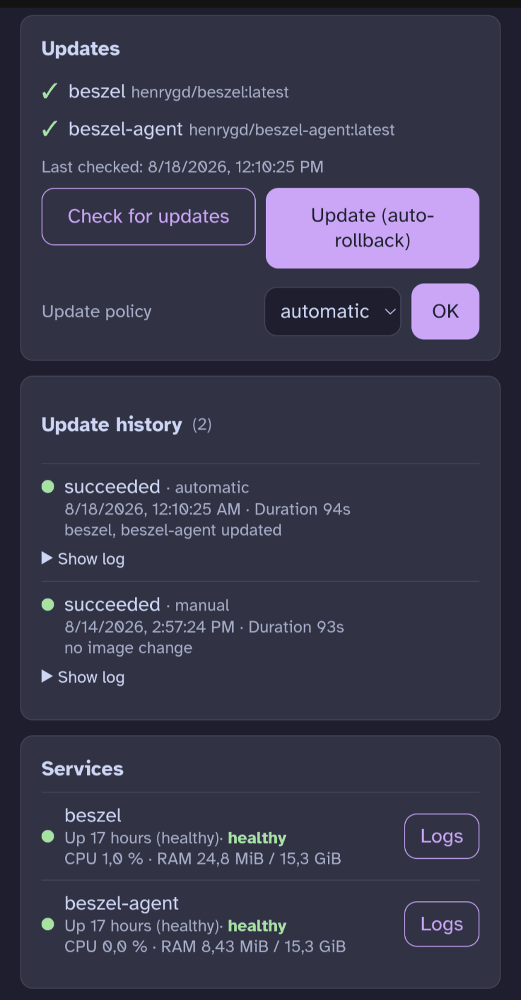
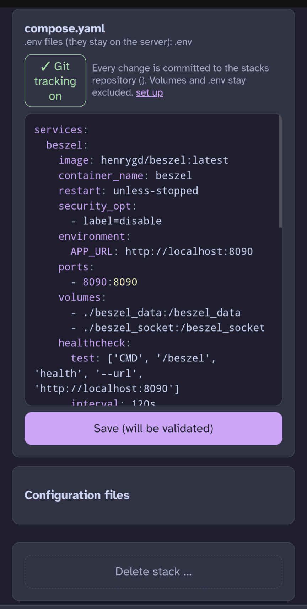
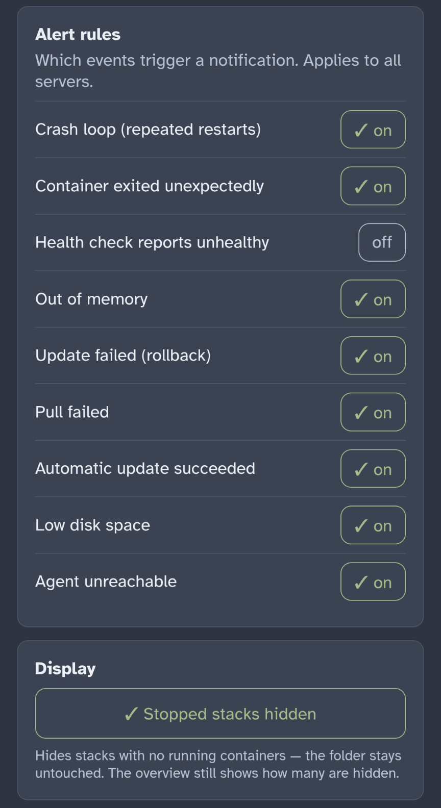
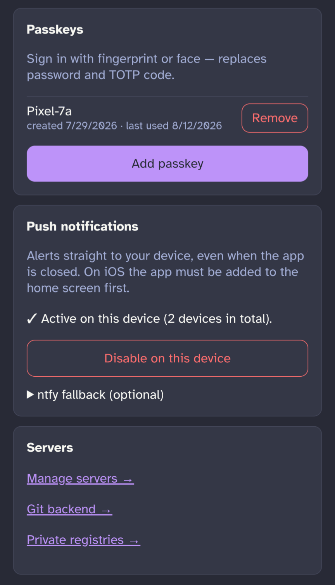
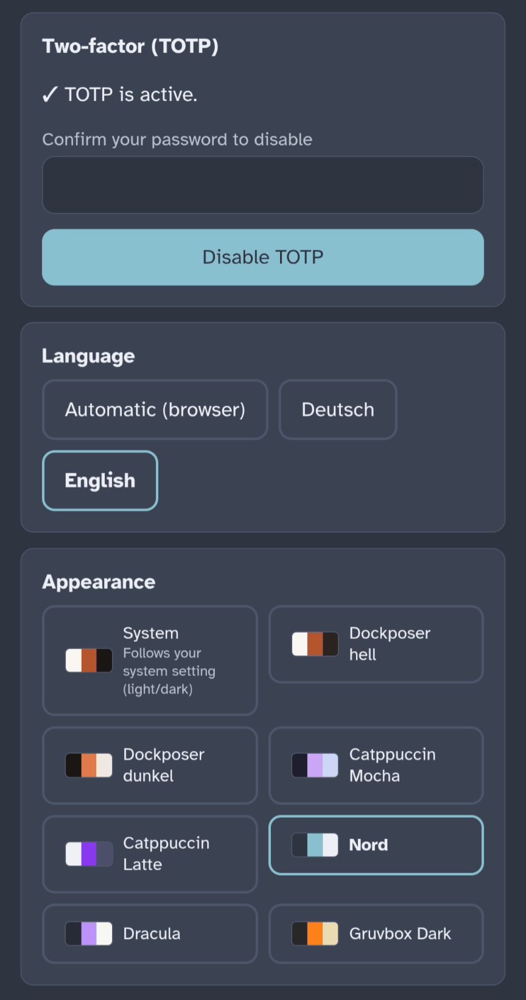

# Dockposer

**Lean Docker Compose management for multiple servers. Mobile-first PWA. The filesystem is the source of truth.**

Dockposer manages Compose stacks that live as ordinary files in `~/stacks` (or any path you configure) on each of your servers. It adopts existing setups as they are, never takes ownership of your files, and stays usable alongside the CLI. Running `docker compose up` over SSH breaks nothing — Dockposer notices the change and shows it.

> Status: used in production on the author's homelab. Interfaces are stable; expect occasional rough edges.

---

## Why another one?

Tested and set aside: **Portainer** (heavy, moves compose files into its own database), **Dockge** (Node.js overhead per instance, single-host thinking), **Dockhand** (weak mobile overview), **Arcane** (destroyed deployments during stack adoption), **Komodo** (powerful but overwhelming), **Dokploy/Coolify** (PaaS philosophy, Traefik lock-in).

Dockposer fills the gap: **Compose only, multi-server through tiny agents, genuinely usable on a phone, and an alerting system that pushes straight to your device.**

### What it does

- **Manage stacks** — start, stop, restart, edit `compose.yaml` with validation before writing, create and delete stacks
- **Alerting with Web Push** — crash loops, unexpected exits, OOM kills, failing health checks, agents going offline, low disk space. Delivered to your phone via Web Push (no third-party service required) or ntfy
- **Updates with automatic rollback** — checks registries for new image digests, updates on request or on a schedule, watches a stabilisation window and rolls back to the previous digests if containers fail to come up healthy
- **Live status** — per-stack state, per-service health and resource usage, streamed logs and command output
- **Config editing** — `.env` and other allow-listed files (e.g. `Caddyfile`) directly in the UI
- **Optional Git backend** — every change committed to a repo in the stacks folder, with a sensible `.gitignore` that keeps volumes and secrets out
- **Visibility** — shows containers running outside the stacks folder so nothing hides from you

### What it deliberately does not do

No web terminal (it links to your native SSH client via `ssh://` instead), no registry browser, no volume explorer, no network management, no Kubernetes, no Swarm, no building images from Git, no multi-tenant RBAC.

Feature bloat is the documented cause of death for half the competition. Anything not on the list above needs a very good reason.

---

## Screenshots

All screenshots are from a phone — that is the primary target. Detail views also work on desktop.

<table>
  <tr>
    <td align="center" valign="top" width="33%">
      <a href="docs/screenshots/stack-updates.png"></a>
      <br><sub><b>Stack detail</b><br>Update check, history, live health</sub>
    </td>
    <td align="center" valign="top" width="33%">
      <a href="docs/screenshots/compose-editor.png"></a>
      <br><sub><b>Compose editor</b><br>Validated before writing, optional Git tracking</sub>
    </td>
    <td align="center" valign="top" width="33%">
      <a href="docs/screenshots/alert-rules.png"></a>
      <br><sub><b>Alert rules</b><br>Pick what reaches your phone</sub>
    </td>
  </tr>
  <tr>
    <td align="center" valign="top">
      <a href="docs/screenshots/settings-push.png"></a>
      <br><sub><b>Passkeys &amp; push</b><br>Fingerprint login, Web Push per device</sub>
    </td>
    <td align="center" valign="top">
      <a href="docs/screenshots/settings-themes.png"></a>
      <br><sub><b>Two-factor, language, themes</b><br>German &amp; English, eight themes</sub>
    </td>
    <td></td>
  </tr>
</table>

---

## Requirements

**Core** (one machine, must be always on): Docker with the Compose plugin, a reverse proxy terminating TLS. HTTPS is mandatory — service workers and Web Push do not work without it.

**Agent** (each managed server): Linux x86-64, Docker with the Compose plugin, a user in the `docker` group. `git` only if you want the Git backend.

---

## Quick start

### 1. Core

```sh
git clone <your-fork> dockposer && cd dockposer/core
cp .env.example .env
```

Fill in `.env`:

```env
ORIGIN=https://dockposer.example.com
SESSION_SECRET=        # openssl rand -hex 32
ENCRYPTION_KEY=        # openssl rand -hex 32
STACKS_PATH=/home/user/stacks
LOCAL_AGENT_TOKEN=     # openssl rand -hex 32
EDITABLE_FILES=.env    # e.g. ".env,Caddyfile"
```

```sh
docker compose up -d --build
```

The core listens on `127.0.0.1:3000`. Point your reverse proxy at it, for example with Caddy:

```
dockposer.example.com {
    reverse_proxy 127.0.0.1:3000
}
```

Open the URL and create the admin account. Set up TOTP or a passkey before doing anything else.

### 2. Agents

The compose file already starts an agent for the machine the core runs on. Register it in the UI under **Settings → Servers** with the URL `http://agent:8720` and the `LOCAL_AGENT_TOKEN` you generated.

For every other server: register it in the UI first (leave the token field empty to have one generated and shown once), then run on that server:

```sh
curl -fsSL <RAW-BASE>/agent/install.sh | sudo sh -s -- \
  --base <RAW-BASE> \
  --token <TOKEN-FROM-THE-UI> \
  --user <docker-user> \
  --listen <interface-ip>:8720
```

`<RAW-BASE>` is your repository's raw URL up to `…/raw/branch/main`. The installer is idempotent — run it again to update the agent binary.

**Do not skip `--listen`.** The agent binds to `127.0.0.1` by default, which makes it unreachable from the core on another machine. Use the address of the interface the core reaches it on (VPN or LAN). See [`agent/README.md`](agent/README.md) for details, firewall rules and troubleshooting.

---

## Architecture

```
                 ┌──────────────────────────────┐
                 │   Dockposer Core (SvelteKit) │
                 │  UI · API · alert pipeline   │
                 │  SQLite · Web Push           │
                 └──────┬───────────┬───────────┘
        HTTPS (proxy)   │           │  outbound: registry HEAD requests
                        │           │  (update detection)
         ┌──────────────┼───────────┼──────────────┐
         │ token auth   │           │              │
   ┌─────▼─────┐  ┌─────▼─────┐  ┌──▼────────┐
   │  Agent 1  │  │  Agent 2  │  │  Agent 3  │     per server:
   │ (Go, tiny)│  │           │  │           │     - Docker socket (local)
   │           │  │           │  │           │     - read/write ~/stacks
   └───────────┘  └───────────┘  └───────────┘     - run docker compose
```

**All connections go from core to agent.** Agents need a reachable port but no callback setup. They are deliberately dumb: they run compose commands, stream events and stats, and report filesystem state. Crash-loop counting, alert decisions and digest comparisons all happen in the core.

Agents hold no state beyond their config file. If an agent dies, everything keeps running — it is a pass-through to the Docker socket and the filesystem, nothing more.

**Stack:** SvelteKit (Node adapter, Svelte 5 runes) · SQLite via Drizzle ORM · `jose` for sessions, TOTP, WebAuthn · `web-push` for notifications · Go standard library for the agent.

---

## Security

- Second factor required: TOTP or WebAuthn/passkeys. A passkey replaces password and TOTP — device possession plus biometrics are already two factors
- Sessions are signed cookies backed by a database table, so they can be revoked
- Agent tokens, TOTP secrets, registry credentials and Git remotes are encrypted at rest (AES-256-GCM) with `ENCRYPTION_KEY`
- Rate limiting on login and TOTP endpoints
- The agent only exposes files you allow-list, only directly inside stack folders, and rejects path traversal
- Agents should bind to a VPN or LAN interface and be firewalled to the core's address. They are not designed to face the public internet unauthenticated
- Dockposer never manages credentials on your servers: `docker login` for private registries and SSH deploy keys for Git pushes stay yours

---

## Documentation

- [`agent/README.md`](agent/README.md) — agent installation, `--listen`, firewall, editable config files, Git backend, private registries, troubleshooting
- [`docs/architektur.md`](docs/architektur.md) — full architecture and design decisions (German)

---

## Contributing

Bug reports and focused pull requests are welcome. Before proposing a feature, please check the "deliberately does not do" list above — the scope limit is the point, not an oversight.

---

## License

[GNU Affero General Public License v3.0](LICENSE).

If you run a modified version as a network service, the AGPL requires you to offer its source to users of that service.
